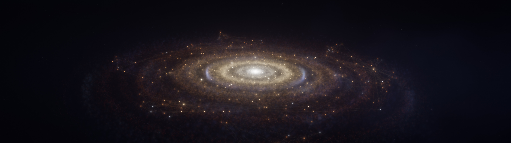
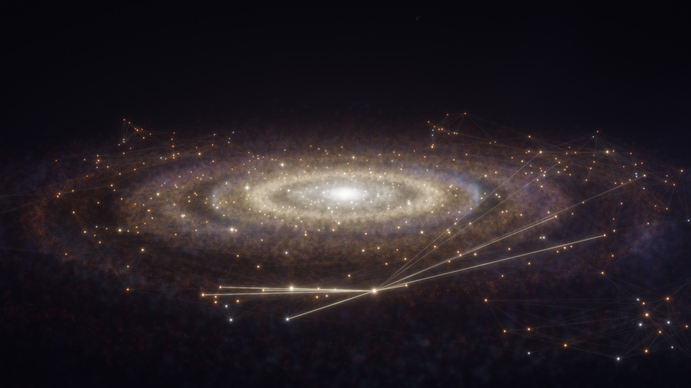

# Astral Palace

**Your Obsidian vault as a living galaxy, rendered as your desktop wallpaper.**

Every note becomes a star. Links become faint constellation lines. Dense corners of your
knowledge glow brighter, your most-linked notes burn white-hot, and the whole disk turns
slowly in 3D. Hover a star to see what it is; click it to open the note in Obsidian.



<sub>Shown with the bundled demo vault: about 440 science & astronomy notes.</sub>

## Features

- **A live map of your vault.** Notes are laid out by their links (a ForceAtlas2-style
  layout) and flattened into a galactic disk: clusters stay together, hubs sink toward the core.
  Orphan notes are left out; an archive folder becomes a dim outer halo.
- **Updates as you write.** New notes and links glide into place within seconds.
- **Hover and click.** A star flares, its title fades in and its links light up; click to open
  the note in Obsidian.
- **Search and fly.** Press a shortcut, start typing: matching stars brighten while the rest of
  the galaxy dims. Pick one and the camera flies there and follows it as the galaxy turns.
- **Drag, zoom, reset.** Drag empty space to move the galaxy, scroll to zoom, double-click to
  glide back.
- **Spans multiple monitors** as one continuous scene with a shared camera.
- **Built to look right.** HDR additive stars, a 7-level bloom chain, a filmic tonemap, dithered
  gradients, and orbiting accretion-disk dust.
- **Light on the GPU.** Native GLSL, no browser engine. About 1.5 ms per 4K frame on an RTX 5070 Ti,
  30 fps while idle, full rate while you interact, and no rendering at all on monitors your
  windows cover (on Hyprland).
- **Optional Omarchy theme**, also called Astral Palace. It recolours your terminals, bar and apps
  to match, and starts or stops the galaxy as you switch themes.



## Requirements

- **Linux on Wayland**, with a compositor that supports the layer-shell protocol: Hyprland, Sway,
  river, niri, Wayfire and others. GNOME and KDE Plasma are not supported.
- Python 3.11+, GTK 4, [gtk4-layer-shell](https://github.com/wmww/gtk4-layer-shell),
  PyGObject, and `inotify-tools`.
- OpenGL 3.3.

**Tested on:** Hyprland (Omarchy), NVIDIA RTX 5070 Ti, two 4K monitors at 1.5× scaling.
Other GPUs and compositors should work but haven't been tested yet. Issues and reports are welcome.

## Install

```sh
git clone https://github.com/mbra323-ops/astral-palace
cd astral-palace
./install.sh                            # try it with the demo vault first
bin/astral-palace
```

Then point it at your own vault:

```sh
./install.sh --vault "~/Documents/My Vault" --force
```

The installer checks system dependencies (and prints the package names for Arch, Fedora and
Debian/Ubuntu if any are missing), creates a virtualenv, and writes
`~/.config/astral-palace/config.toml`.

**Start at login:** add `bin/astral-palace` to your compositor's autostart
(for example `exec-once = /path/to/astral-palace/bin/astral-palace` in Hyprland).

**Search shortcut:** bind a key to `bin/astral-palace-search`. The installer prints the exact
line for Hyprland and Sway.

### Omarchy

```sh
./install.sh --vault "~/Documents/My Vault" --omarchy
omarchy theme set "Astral Palace"
```

This installs the theme plus `theme-set` / `post-boot` hooks, so the galaxy runs only while
Astral Palace is your theme. With `--chromium-force-dark`, Chromium also auto-darkens web pages
that have no dark mode while the theme is active.

## Using it

| | |
|---|---|
| Hover a star | Title, folder and link count; its constellation lights up |
| Click a star | Open the note in Obsidian |
| Drag empty space | Move the galaxy anywhere across your monitors |
| Scroll | Zoom |
| Double-click empty space | Glide back to the default view |
| Search shortcut | Galaxy rises above your windows with a search bar |
| ↑ ↓ / Enter | Pick a result / fly to it |
| Enter (after flying) | Open the note |
| Esc | Glide back and sink behind your windows |

Clicks only reach the wallpaper on empty desktop space, so it's at its best on an empty workspace.
Search gets around that by temporarily raising the galaxy above your windows.

**Opening notes from the demo vault:** open `demo-vault/` in Obsidian once ("Open folder as
vault"), so the `obsidian://` links know where it is.

## Configuration

Copy [`config.example.toml`](config.example.toml) to `~/.config/astral-palace/config.toml`.
You can change the vault, camera, rotation speed, colours, bloom, idle frame rate, background
glow and more. Restart to apply. Every default lives in [`galaxy/config.py`](galaxy/config.py).

Your view position and zoom are saved to `~/.local/state/astral-palace/state.json`, and the
computed layout is cached in `~/.cache/astral-palace/`.

## How it works

| | |
|---|---|
| [`galaxy/vault.py`](galaxy/vault.py) | Parses `[[wikilinks]]`, embeds and Markdown links into an undirected graph |
| [`galaxy/layout.py`](galaxy/layout.py) | ForceAtlas2-style layout (cached per vault), mapped onto a warped exponential disk |
| [`galaxy/scene.py`](galaxy/scene.py) | Star colour and brightness, dust, camera path, transitions, picking |
| [`galaxy/render.py`](galaxy/render.py), [`glsl.py`](galaxy/glsl.py) | HDR star sprites, max-blended link layer, half-res dust, 7-level bloom, ACES tonemap |
| [`galaxy/app.py`](galaxy/app.py) | GTK 4 layer-shell surface per monitor, input, search, Hyprland pause, vault watcher |
| [`galaxy/snapshot.py`](galaxy/snapshot.py) | Headless renderer for screenshots (`python -m galaxy.snapshot out.png`) |
| [`tools/make_demo_vault.py`](tools/make_demo_vault.py) | Regenerates the demo vault |

**Privacy:** Astral Palace only reads your vault locally. Nothing is sent anywhere.

## Licence

MIT © Taita. Astral Palace is not affiliated with or endorsed by Obsidian.
